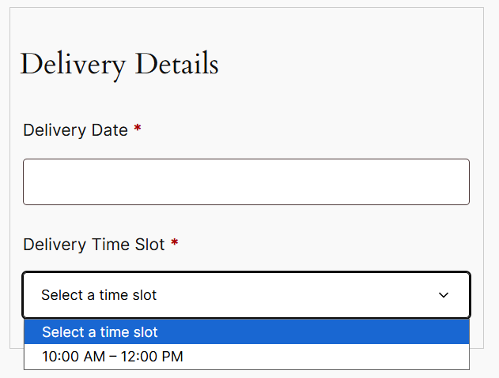
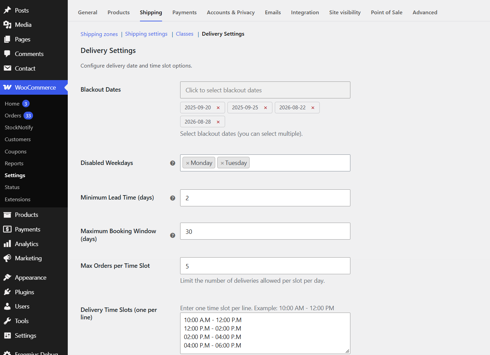
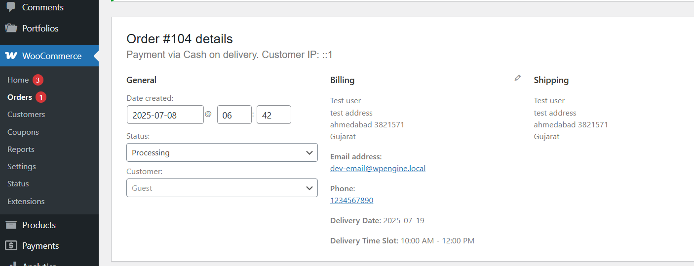
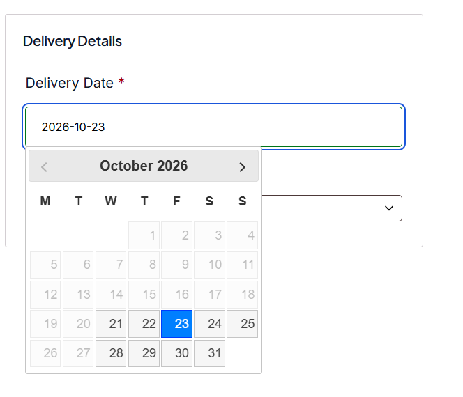
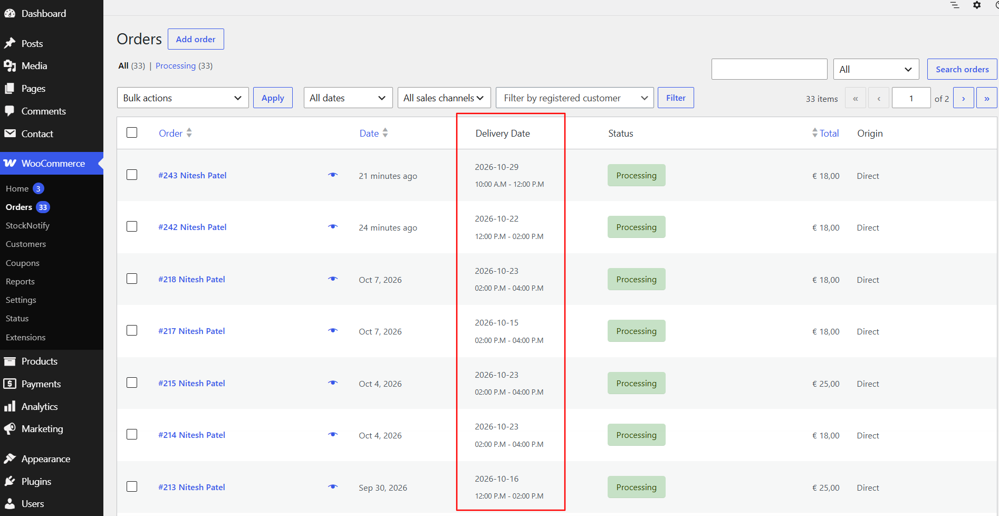

# Delivery Date & Time Slot Picker for WooCommerce

Let your customers select a delivery date and time slot during WooCommerce checkout. Perfect for local delivery services like bakeries, grocery stores, or flower shops.

## 🔥 Features

- Delivery Date Picker at checkout (Classic and Blocks checkout)
- Admin-configurable Delivery Time Slots, validated server-side
- Limit orders per time slot (enforced at checkout)
- Blackout Dates via calendar (multi-select, shown as removable tags)
- Disabled Weekdays, e.g. no delivery on Sundays
- Minimum Lead Time, the earliest delivery date in days from today
- Maximum Booking Window, how far ahead customers can book
- HPOS and Cart & Checkout Blocks compatible
- WooCommerce shipping method compatibility
- Delivery details shown on the admin order screen, thank-you page and My Account
- Quick "Settings" link on the Plugins screen
- Delivery Date column on the Orders list
- Consistent "Delivery Details" card on order confirmation (Classic and Blocks)

## ✅ Requirements

- WordPress 6.0+ (tested up to 7.1)
- WooCommerce (tested with 11.1)
- PHP 7.4+

## 📸 Screenshots

| Checkout View | Admin Settings |
|---------------|----------------|
|  |  |

| Admin Order Details | Checkout Calendar Rules |
|---------------------|-------------------------|
|  |  |

| Orders List Column |
|--------------------|
|  |

## ⚙️ Delivery Rules

Found under **WooCommerce > Settings > Shipping > Delivery Settings**.

| Setting | What it does |
|---------|--------------|
| Blackout Dates | Specific calendar dates that cannot be selected |
| Disabled Weekdays | Days of the week with no delivery. Selecting all 7 days is ignored so checkout always has available dates |
| Minimum Lead Time (days) | Earliest delivery date, counted from today. `0` allows same-day delivery, `2` makes the day after tomorrow the earliest date |
| Maximum Booking Window (days) | How many days ahead customers can book. `0` means no limit. Never lower than the lead time |
| Max Orders per Time Slot | Maximum orders for one date and time slot combination |
| Delivery Time Slots | One slot per line |

All rules are applied in the date picker and re-checked server-side on both Classic and Block checkout, so they cannot be bypassed by editing the date field. Dates are evaluated in the store timezone.

## 📥 Installation

1. Upload the plugin to your WordPress `/wp-content/plugins/` directory.
2. Activate it via the **Plugins** menu.
3. Go to **WooCommerce > Settings > Shipping > Delivery Settings** to configure.

## 🌍 Translations

This plugin is translation-ready. `.pot` file is located in `/languages/`.

## 📝 Changelog

### 1.8
- Added a Disabled Weekdays setting to block delivery on chosen days of the week
- Added a Minimum Lead Time setting (earliest delivery date in days from today)
- Added a Maximum Booking Window setting (how far ahead customers can book)
- Rules are enforced in the date picker and server-side on Classic and Block checkout
- Regenerated the `.pot` translation template with the new strings

### 1.7
- Added a Delivery Date column (with time slot) to the WooCommerce Orders list, HPOS and legacy storage
- Unified card-style Delivery Details table on order-received, order-details and My Account pages
- Blocks order confirmation heading now reads "Delivery Details" instead of "Additional information"
- Added `delivery-order-details.css`, loaded only on order pages

See `readme.txt` for the full history.

## 📜 License

Licensed under [GPLv2 or later](https://www.gnu.org/licenses/gpl-2.0.html).

---

## 🤝 Contribute

Feel free to submit PRs or report issues!